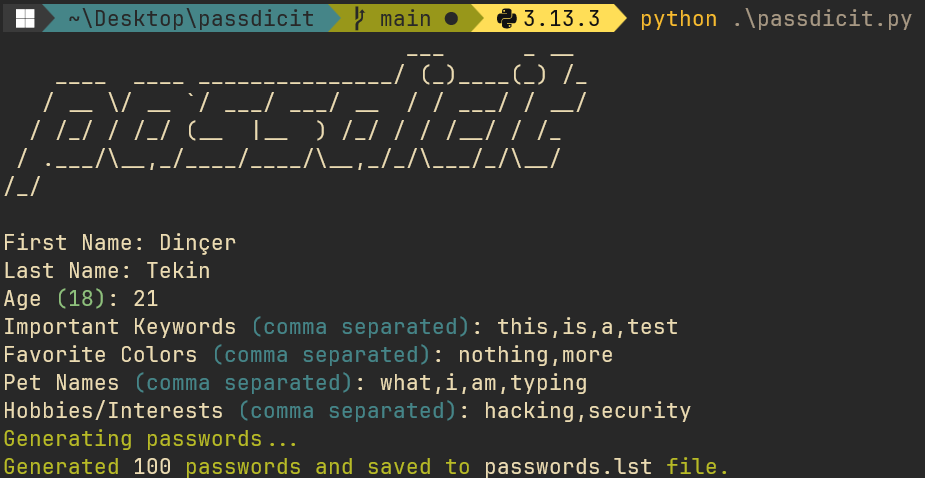

# passdict

<p>
  <picture><source media="(prefers-color-scheme: dark)" srcset="https://raw.githubusercontent.com/dincertekin/dincertekin/main/assets/badges/python-313-dark.svg"></picture>
  <a href="LICENSE"><picture><source media="(prefers-color-scheme: dark)" srcset="https://raw.githubusercontent.com/dincertekin/dincertekin/main/assets/badges/mit-dark.svg"></picture></a>
</p>

**Build a wordlist from what you know about a person.** Answer a few
questions (name, age, pets, hobbies, favorite colors, keywords) and passdict
mixes the answers into a password list for authorized password audits.



It shows how guessable passwords built from personal details are. If a
password could come out of this tool, it's a weak password.

> For authorized security testing and education only. Don't use it against
> accounts you don't own or have permission to test.

## Install

Requires Python 3.13+.

```bash
git clone https://github.com/dincertekin/passdict.git
cd passdict
pip install -r requirements.txt     # or: poetry install
```

## Usage

```bash
python passdict.py                          # 100 passwords, 6 to 12 characters
python passdict.py --min 8 --max 16 -l 5000 # 5,000 passwords, 8 to 16 characters
```

passdict asks for the details one by one (lists are comma separated), then
writes the passwords to `passwords.lst` in the current folder, ready for tools
like Hashcat, John the Ripper or Hydra.

| Option | Default | What it does |
|---|---|---|
| `-a`, `--min` | 6 | Minimum password length |
| `-z`, `--max` | 12 | Maximum password length |
| `-l`, `--limit` | 100 | How many passwords to generate |

Inspired by [CUPP](https://github.com/Mebus/cupp).

## License

[MIT](LICENSE)
